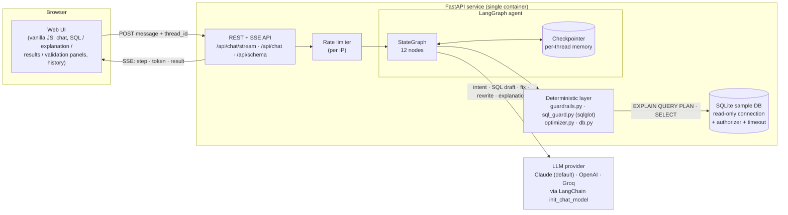
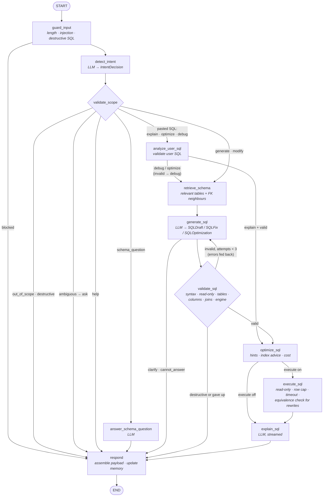

# Architecture

## System overview

**Split of responsibilities.** The LLM is used for language: classifying intent, drafting or repairing SQL, and explaining it. Everything that must be *correct* is deterministic code: scope enforcement, read-only enforcement, table/column/join validation, cost estimation, index advice, execution, and result-equivalence checks. The LLM never has the final say on whether SQL is safe or valid.

## LangGraph workflow

This diagram matches the compiled graph; `build_graph(...).get_graph().draw_mermaid()` prints the raw version.

### Nodes

| Node | Kind | What it does |
|---|---|---|
| `guard_input` | deterministic | Resets per-turn state. Rejects empty or oversized input, prompt-injection patterns (`ignore previous instructions`, `reveal your system prompt`, fake `</system>` tags, …) and pasted destructive SQL **before any LLM call**. |
| `detect_intent` | LLM | Classifies into `generate_sql · modify_sql · explain_sql · optimize_sql · debug_sql · schema_question · help · destructive · out_of_scope · ambiguous` and extracts any pasted SQL. Sees the previous query and recent turns. |
| `validate_scope` | deterministic | Turns the intent into a decision: refuse (out of scope or destructive), ask a clarifying question, show help, or pick a processing *mode*. "Explain that" with no pasted SQL falls back to the previous query. |
| `analyze_user_sql` | deterministic | Validates pasted SQL. Explaining or optimizing broken SQL switches to **debug** mode, since it has to be fixed first. Validator findings are passed to the LLM. |
| `retrieve_schema` | deterministic | Scores tables by lexical and synonym overlap with the request (plus the previous SQL for follow-ups) and adds foreign-key neighbours. Small schemas (≤12 tables) send the whole schema, which is cheap and avoids missing a join path. Larger schemas send only the relevant subset. |
| `generate_sql` | LLM | One node, three prompts by mode. **generate/modify** → `SQLDraft` (may return `needs_clarification` or `cannot_answer` instead of guessing). **debug** → `SQLFix` (issues + corrected SQL). **optimize** → `SQLOptimization` (rewrite, improvements, removed joins, index advice), seeded with the plan-based analyzer findings. On a retry, the validator's errors are appended. |
| `validate_sql` | deterministic | The hard guardrail; see below. On failure it loops back to `generate_sql` with the errors, up to `MAX_GENERATION_ATTEMPTS`. A destructive draft is never retried. |
| `optimize_sql` | deterministic | `EXPLAIN QUERY PLAN` cost estimate (full scans, index lookups, temp B-trees, estimated rows examined). Also: SELECT \*, missing LIMIT, non-sargable predicates (`strftime(col) = …`), leading-wildcard LIKE, index recommendations for filtered columns on fully-scanned tables, and **unnecessary joins** (a table joined on its primary key that contributes no columns). |
| `execute_sql` | deterministic | Runs on a read-only connection. For optimize mode it also runs the original query and compares result sets, so a rewrite that changes semantics is flagged in the UI. |
| `explain_sql` | LLM | 2–5 plain-English sentences, streamed token by token to the UI. If it fails, the validated SQL is still returned. |
| `answer_schema_question` | LLM | Answers "what tables are there / how do Orders relate to Customers". |
| `respond` | deterministic | Builds the response payload (SQL in SQLite/PostgreSQL/MySQL via sqlglot, validation report, optimization, results). Stores a compact summary plus SQL in conversation memory and updates `last_sql`. |

### State and conversation memory

`AgentState` ([`app/agent/state.py`](../app/agent/state.py)) is checkpointed per `thread_id` (one per chat in the UI) by LangGraph's checkpointer. Two fields persist across turns:

- `messages`: the transcript. The last `HISTORY_TURNS` turns are given to the intent and generation prompts.
- `last_sql`: the most recent **validated** query. A `modify_sql` turn ("only those from California") gets it as `<previous_sql>` and is instructed to *modify* rather than restart.

All other fields are per-turn and reset by `guard_input`. The browser keeps its own copy of each conversation (localStorage) for the history sidebar.

## Guardrails (defence in depth)

| Layer | Where | Stops |
|---|---|---|
| 1. Input checks | `guardrails.py` | Oversized input, prompt-injection phrasing, pasted DELETE/UPDATE/INSERT/DROP/ALTER/TRUNCATE/PRAGMA/ATTACH, all before the LLM is called. |
| 2. Intent + scope | `detect_intent` → `validate_scope` | General knowledge, sports, politics, maths, creative writing and non-SQL coding are refused with the required message. Destructive requests in natural language are refused politely. |
| 3. Prompt design | `prompts.py` | User text is fenced in tags and declared to be data. Schema-only rule. `cannot_answer` escape hatch instead of hallucinating. |
| 4. SQL validator | `sql_guard.py` | (a) token-level forbidden-keyword scan, so a string literal like `'Deleted'` is fine; (b) exactly one statement; (c) AST root must be SELECT/set operation and no write nodes anywhere, including inside CTEs; (d) every table exists, with "did you mean" suggestions; `sqlite_master` is not in the schema; (e) every column resolves (sqlglot qualifier); (f) join keys type-compatible, with non-FK joins and cartesian products flagged; (g) SQLite compiles it (`EXPLAIN QUERY PLAN`). |
| 5. Execution sandbox | `db.py` | `mode=ro` URI connection, `PRAGMA query_only`, an SQLite **authorizer** that denies anything except SELECT/READ/FUNCTION, a progress-handler timeout, and a row cap. A write that somehow passed every earlier layer still cannot run (see `test_readonly_connection_refuses_writes_even_without_validator`). |
| 6. Service | `main.py` | Per-IP rate limit, request schema validation (length, thread-id format), friendly errors instead of stack traces. |

## Key design decisions

- **A deterministic validator instead of an "LLM judge".** sqlglot plus the SQLite engine give exact, explainable errors ("Column 'FirstNme' could not be resolved. Did you mean 'FirstName'?"). Those errors drive the self-correction loop, so the model fixes real problems rather than guessed ones.
- **Validation uses the real engine as the final check.** sqlglot is permissive about functions and dialect quirks. Compiling with `EXPLAIN QUERY PLAN` catches the rest without executing anything.
- **One `generate_sql` node, three modes.** Generate, debug and optimize share the same validate → retry loop, so every path gets identical guarantees.
- **Equivalence checking for optimizations.** Readability and performance rewrites are verified by running both queries, so "optimized" never silently means "different".
- **Provider-agnostic.** `init_chat_model("provider:model")`. The default is Claude (`claude-opus-5-5`, effort `low` for chat latency) with native JSON-schema structured output; OpenAI and Groq work by changing env vars.
- **Streaming UX.** The UI subscribes to LangGraph `updates` (one progress step per node) and `messages` (explanation tokens) over Server-Sent Events.

## Limitations / next steps

- Memory is in-process (`InMemorySaver`). Run a single worker, or swap in `langgraph-checkpoint-postgres` / `-sqlite` for durable, multi-worker memory.
- Schema retrieval is lexical. For schemas with hundreds of tables, replace it with embedding search over table and column descriptions. The node interface stays the same.
- Execution targets SQLite. PostgreSQL and MySQL output is transpiled for copy/download but not executed.
